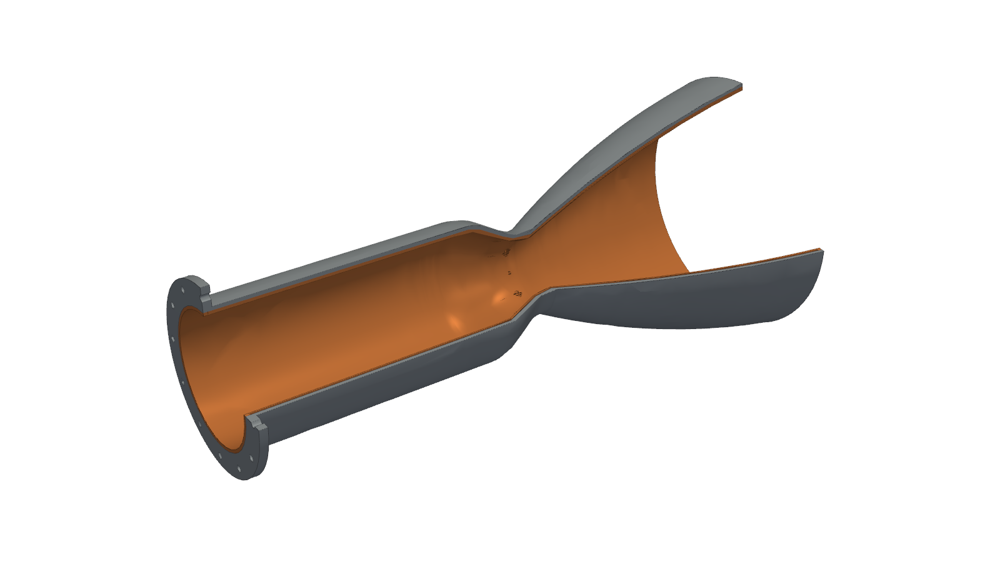
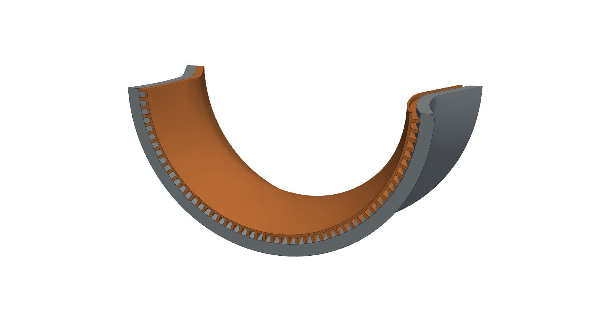

# Rocket Thrust Chamber Designer

**Preliminary design of a regeneratively cooled liquid-rocket thrust chamber, from requirements to SolidWorks-ready CAD.**

You enter thrust, chamber pressure and propellant. The program sizes the nozzle, designs the cooling
channels, checks that the walls survive the heat and pressure, and builds a 3-D model with all
100 cooling channels that opens directly in SolidWorks.



| Throat slice: 100 milled cooling channels in a GRCop-42 copper liner, closed out by an Inconel 718 jacket |
|---|
|  |

🔗 **[Open the interactive 3D calculator](https://alpemin.github.io/rocket-thrust-chamber-designer/web/)**
Enter thrust, chamber pressure and propellant, and get a rotatable 3D thrust chamber with all 100 cooling
channels, a heat-flux colour map and a SolidWorks curve export, live in your browser.

🧊 **3D model of the example engine:** [`thrust_chamber.stl`](outputs/methane_100kN/thrust_chamber.stl) opens in GitHub's built-in 3D viewer, so you can rotate it right here.

---

## Results for the example engine

A 100 kN (22,500 lbf) sea-level LOX/methane engine at 100 bar, the propellant combination SpaceX uses in Raptor.

| | |
|---|---|
| Specific impulse (sea level / vacuum) | **303 s / 325 s** |
| Throat / exit diameter | 88.0 mm / 305 mm |
| Propellant flow | 33.7 kg/s (7.3 kg/s methane) |
| Peak gas-side heat flux | **62 MW/m²** at the throat |
| Peak copper wall temperature | **926 K** (limit ≈ 1000 K) |
| Methane coolant | 120 K → 429 K, 22 bar pressure drop |
| Liner stress margin (lowest) | **+0.47** at the throat |
| Estimated mass | 17.8 kg |

Full report: [`outputs/methane_100kN/REPORT.md`](outputs/methane_100kN/REPORT.md)


---

## How it works, step by step

**1. Size the engine (ideal rocket theory).** From chamber pressure and the combustion gas properties,
the program computes the characteristic velocity *c\** and the thrust coefficient *C<sub>F</sub>*. The
throat area follows from *A<sub>t</sub> = F / (C<sub>F</sub> p<sub>c</sub>)*. The exit Mach number comes from
inverting the isentropic area–Mach relation for the chosen expansion ratio.

**2. Draw the contour.** Cylindrical chamber (length set by the characteristic length *L\**) → fillet →
30° converging cone → throat arcs of 1.5 *R<sub>t</sub>* and 0.382 *R<sub>t</sub>* → **Rao 80% bell nozzle**
(a parabola between the wall angles θ<sub>n</sub> and θ<sub>e</sub>). The curve is tangent-continuous, so it can be
offset outward to make the liner, channel and jacket layers.

**3. Gas-side heat transfer (Bartz correlation).** The heat-transfer coefficient from the hot gas
to the wall, corrected for boundary-layer property changes. The heat flux peaks just upstream of the throat.

**4. Regenerative cooling (1-D march).** All the methane flows through 100 rectangular channels milled into the
copper liner, from the nozzle exit toward the injector. At each of 600 stations the program:
- balances three thermal resistances in series: hot gas → copper wall → coolant;
- gets the coolant-side coefficient from Dittus–Boelter, with **fin efficiency** for the copper ribs;
- uses **real-fluid methane properties (CoolProp)**, because methane passes through its critical point here;
- adds the absorbed heat to the coolant and subtracts the friction pressure drop (Haaland friction factor, 10 µm roughness).

**5. Structural check.** Two stresses act on the 0.7 mm hot wall:
- *Thermal stress* from the temperature drop across the wall, σ = Eα q t / (2(1−ν)k). It is
  self-limiting (secondary).
- *Pressure bending*: the 160 bar coolant pushes the wall between ribs into the chamber gas, σ = Δp w² / (2t²).
  This one is primary.

Following the ASME shakedown approach, primary stress must stay under yield / safety factor, and primary + secondary under 2 × yield.

**6. Jacket.** An Inconel 718 closeout sized for hoop stress at the highest coolant pressure,
plus an injector flange with 12 bolt holes.

**7. CAD.** CadQuery (OpenCASCADE) revolves each layer, cuts 100 channel wedges and exports STEP and STL.
The CAD surfaces stay within 0.05 mm of the analysed contour.

---

## Open it in SolidWorks

Download `outputs/methane_100kN/thrust_chamber_assembly_STEP.zip`, unzip it, and open `thrust_chamber_assembly.step` with **File › Open** (file type STEP). The large STEP files are zipped to stay under GitHub's 25 MB upload limit.
To rebuild the model natively from the exported curves, or to check the thermal analysis with
SolidWorks Simulation, follow **[docs/SOLIDWORKS.md](docs/SOLIDWORKS.md)**.

| Output file | Use |
|---|---|
| `thrust_chamber_assembly_STEP.zip` | Liner + jacket assembly (unzip to get the .step): SolidWorks, Fusion 360, Onshape, CATIA, NX, FreeCAD |
| `liner_STEP.zip`, `jacket.step` | Individual parts |
| `thrust_chamber.stl` | 3-D printing a scale model, slicers (GitHub previews it in 3-D) |
| `solidworks_curve_*.txt` | Wall curves for *Insert › Curve › Curve Through XYZ Points* |
| `station_data.csv` | Every quantity at all 600 stations: open in Excel |
| `REPORT.md` + PNGs | Design report and plots |

---

## Run it yourself

```bash
pip install -r requirements.txt
python run.py                                   # example engine, about 3 minutes with CAD
python run.py designs/methane_100kN.json --no-cad   # analysis + plots only, about 1 second
```

To design your own engine, copy `designs/methane_100kN.json`, change the numbers and run it. Propellants:
`LOX/CH4`, `LOX/RP-1`, `LOX/LH2`. Materials: `GRCop-42`, `Inconel 718`, `316L`.

```
tcd/
  data.py         propellant and material properties
  performance.py  ideal rocket sizing
  geometry.py     chamber + Rao bell contour, wall offsets
  cooling.py      Bartz, regenerative cooling march, liner stress, jacket sizing
  cad.py          CadQuery 3-D model, STEP/STL export
  report.py       plots, CSV, SolidWorks curves, Markdown report, renders
designs/          input files (JSON)
outputs/          generated results for the example engine
web/              interactive 3D calculator (GitHub Pages)
docs/             SolidWorks guide, GitHub guide
```

---

## Assumptions and limitations

This is a **preliminary design tool**. Real hardware needs much more analysis.
- Combustion gas properties are single-point approximations, with no change in composition along the
  nozzle. Use NASA CEA for real values.
- Performance is ideal. Real engines lose about 2–5% Isp to combustion efficiency and nozzle divergence.
- Bartz and Dittus–Boelter are empirical correlations accurate to about ±20–30%. Supercritical methane near its
  pseudo-critical point is especially hard to model. The model ignores channel curvature, wall
  roughness effects on heat transfer, film cooling and radiation.
- The 1-D model treats the wall as a flat plate per station. Use 2-D/3-D FEA for the real temperature field
  around the ribs (see docs/SOLIDWORKS.md, Option C).
- Material properties are approximate elevated-temperature values. The model gives no low-cycle-fatigue life estimate.
- Coolant manifolds, injector and ignition are not modelled.

## References
- G. P. Sutton & O. Biblarz, *Rocket Propulsion Elements*, 9th ed., Wiley.
- D. K. Huzel & D. H. Huang, *Modern Engineering for Design of Liquid-Propellant Rocket Engines*, AIAA, 1992.
- D. R. Bartz, "A Simple Equation for Rapid Estimation of Rocket Nozzle Convective Heat Transfer Coefficients," *Jet Propulsion*, 1957.
- G. V. R. Rao, "Exhaust Nozzle Contour for Optimum Thrust," *Jet Propulsion*, 1958.
- I. H. Bell et al., "Pure and Pseudo-pure Fluid Thermophysical Property Evaluation and the Open-Source Thermophysical Property Library CoolProp," *Ind. Eng. Chem. Res.*, 2014.
- ASME Boiler and Pressure Vessel Code, Section VIII Div. 2: primary and secondary stress limits, shakedown.

## How this was built
- Written in Python
- Fuel properties come from CoolProp, a free library with real data for methane, hydrogen and RP-1
- The 3-D model is made with CadQuery and saved as STEP (for SolidWorks) and STL (for 3-D printing)
- The website is plain HTML and JavaScript, with three.js for the 3D view
- The engineering follows standard rocket textbooks (Sutton, and Huzel & Huang) and well-known heat-transfer formulas (Bartz and Dittus–Boelter)

## Author
ALP EMIN TANRISEVEN · [LinkedIn](https://www.linkedin.com/in/alptanriseven/) 

MIT License
