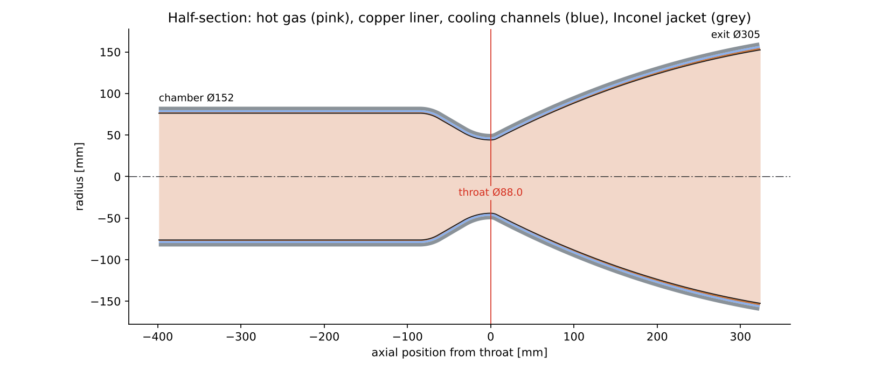
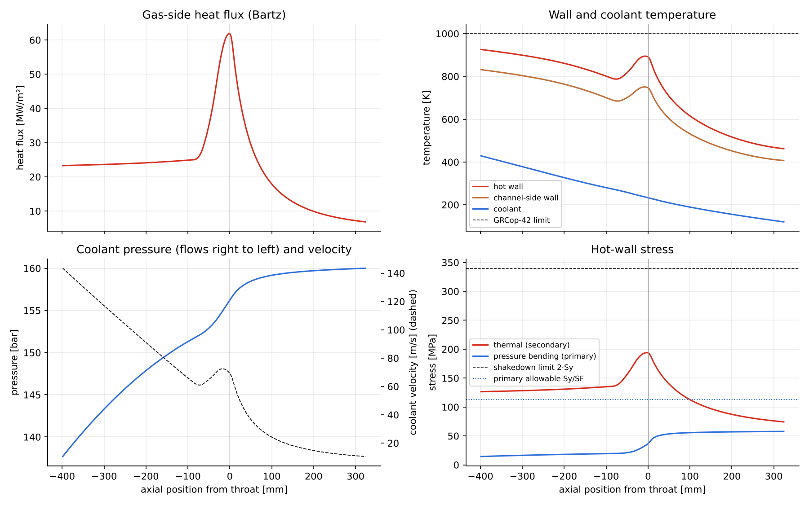
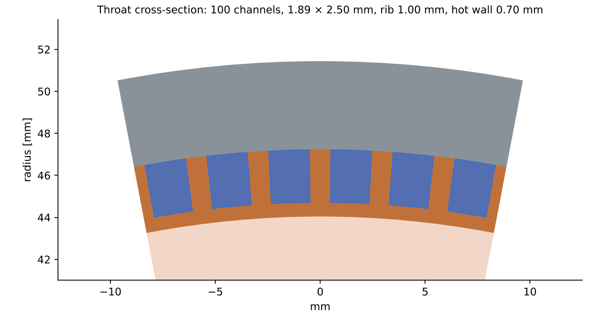

# Design report: 100 kN LOX/methane sea-level engine

Generated by `run.py`. All numbers are preliminary-design estimates (see README, *Assumptions*).

## Performance and geometry
| | |
|---|---|
| Propellant | LOX/CH4 at O/F 3.6 |
| Thrust (design ambient) | 100.0 kN at 1.013 bar |
| Chamber pressure | 100 bar |
| Specific impulse: design / sea level / vacuum | 303 / 303 / 325 s |
| Characteristic velocity c* | 1807 m/s |
| Thrust coefficient C_F | 1.643 |
| Mass flow: total / fuel / oxidizer | 33.69 / 7.32 / 26.37 kg/s |
| Throat / chamber / exit diameter | 88.0 / 152.5 / 305.0 mm |
| Expansion / contraction ratio | 12.0 / 3.0 |
| Exit Mach / exit pressure | 3.41 / 0.986 bar |
| Length: cylinder / converging / nozzle / total | 313 / 85 / 324 / 722 mm |
| Bell angles θn / θe | 27.2° / 9.7° |

## Regenerative cooling and structure
| | |
|---|---|
| Coolant | Methane (all fuel), 7.32 kg/s |
| Channels | 100 × 2.5 mm deep; throat width 1.89 mm, rib 1.00 mm |
| Channel wedge angle (for a SolidWorks revolved cut) | 2.35° of every 3.60° |
| Hot-wall thickness at throat | 0.70 mm (GRCop-42) |
| Total heat load | 8.16 MW |
| Peak heat flux | 61.8 MW/m² |
| Peak hot-wall temperature | 926 K at x = -399 mm (limit ≈ 1000 K) |
| Coolant temperature: in → out | 120 → 429 K |
| Coolant pressure: in → out (drop) | 160.0 → 137.7 bar (22.3 bar) |
| Peak coolant velocity | 143 m/s |
| Lowest liner stress margin | +0.47 at x = 3 mm |
| Jacket thickness | 4.20 mm (Inconel 718) |
| Estimated mass: liner / jacket+flange | 8.8 / 8.9 kg (total 17.8 kg) |

## Design checks
- ✅ All checks pass: wall temperature under the material limit, positive liner stress margins, coolant pressure drop under 30% of chamber pressure.
